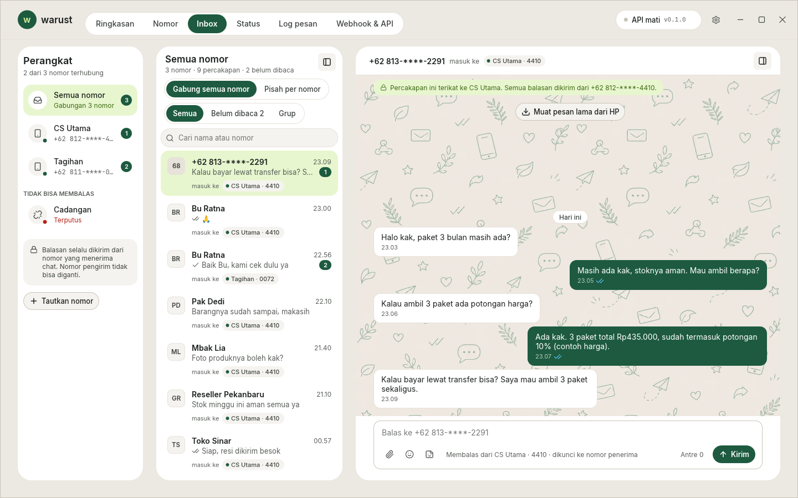
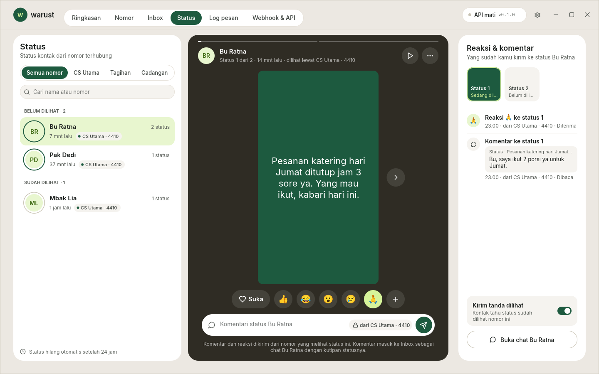
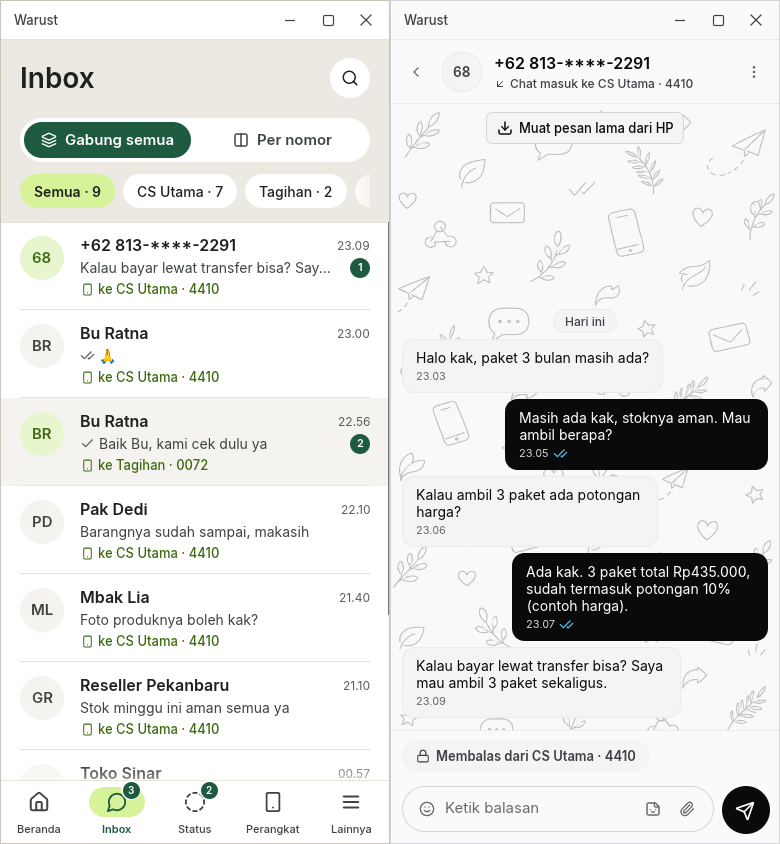
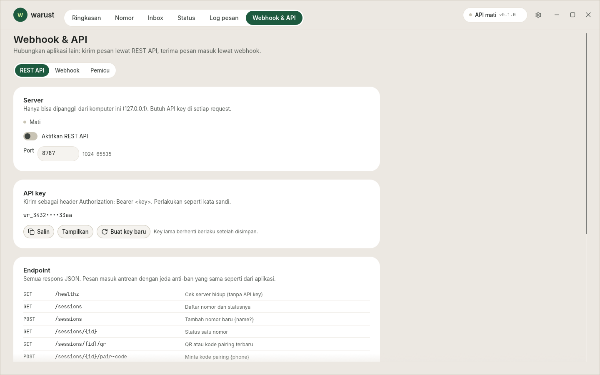

<p align="center">
  
</p>

<h1 align="center">warust</h1>

<p align="center"><strong>Gateway WhatsApp di desktop: banyak nomor, satu inbox.</strong></p>

<p align="center">
  Aplikasi desktop Rust + egui yang menautkan nomor WhatsApp sebagai perangkat pendamping,
  lengkap dengan REST API lokal, webhook bertanda tangan, dan pemicu otomatis. Satu proses, tanpa browser.
</p>

<p align="center"><em>A Rust desktop WhatsApp gateway: many numbers in one inbox, a local REST API,
signed webhooks and triggers. The interface is in Indonesian.</em></p>

<p align="center">
  <a href="#fitur"><strong>Fitur</strong></a> ·
  <a href="#pasang"><strong>Pasang</strong></a> ·
  <a href="#tautkan-nomor"><strong>Tautkan nomor</strong></a> ·
  <a href="#rest-api"><strong>REST API</strong></a> ·
  <a href="#webhook"><strong>Webhook</strong></a>
</p>

<p align="center">
  <a href="Cargo.toml"></a>
  
  <a href="LICENSE"></a>
</p>

<picture>
  <source media="(prefers-color-scheme: dark)" srcset="docs/screenshots/inbox-dark.png">
  
</picture>

<table>
  <tr>
    <td width="38%"></td>
    <td width="24%"></td>
    <td width="38%"></td>
  </tr>
</table>

<p align="center"><sub>Inbox gabungan, halaman Status, jendela seukuran HP (Forest dan Monokrom), dan Webhook & API.
Semua screenshot memakai data contoh.</sub></p>

## Fitur

<table>
  <tr>
    <td width="50%" valign="top"><strong>📥 Inbox gabungan</strong><br>Banyak nomor dalam satu daftar chat. Balasan selalu keluar dari nomor yang menerima chat.</td>
    <td width="50%" valign="top"><strong>🟢 Status & reaksi</strong><br>Lihat status kontak dari semua nomor, kirim reaksi dan komentar sebagai balasan berkutip.</td>
  </tr>
  <tr>
    <td valign="top"><strong>🔌 REST API lokal</strong><br>Kirim teks, foto, dokumen dan stiker lewat HTTP di 127.0.0.1, dengan API key Bearer.</td>
    <td valign="top"><strong>🪝 Webhook bertanda tangan</strong><br>Pesan masuk, status kirim dan status sesi dikirim sebagai JSON dengan HMAC-SHA256 dan coba ulang.</td>
  </tr>
  <tr>
    <td valign="top"><strong>⚡ Pemicu otomatis</strong><br>Aturan teks atau regex yang memanggil API-mu, lalu membalas pengirim setelah jawaban 2xx.</td>
    <td valign="top"><strong>🛡️ Antrean anti-ban</strong><br>Jeda dan jitter per nomor; antrean tetap tersimpan saat aplikasi ditutup.</td>
  </tr>
</table>

Juga: emoji berwarna, kirim foto/dokumen/stiker, rekam pesan suara, pratinjau PDF di aplikasi, tanda kirim ✓✓,
notifikasi desktop (klik untuk membuka chat), dua template (Forest, dan Klasik gelap/terang), serta tata letak HP saat jendela
dikecilkan di bawah 1100 px.

## Pasang

Unduh dari [Releases](https://github.com/soefyan45/warust/releases/latest):

| OS | Berkas | Cara pasang |
|---|---|---|
| Linux (Debian/Ubuntu, x86_64) | `warust_<versi>_amd64.deb` | `sudo apt install ./warust_<versi>_amd64.deb`, lalu buka **warust** dari menu aplikasi |
| Windows 10/11 (x86_64) | `warust-<versi>-windows-x86_64.zip` | Ekstrak, jalankan `warust.exe` |
| macOS 11+ (Apple Silicon dan Intel) | `warust-<versi>-macos-universal.dmg` | Buka, seret **warust** ke Applications |

Versi macOS ditandatangani Developer ID dan dinotarisasi Apple, jadi langsung bisa dibuka.
Versi Windows belum ditandatangani: di SmartScreen klik **Info selengkapnya** → **Tetap jalankan**.

Data (kunci sesi, chat, media, pengaturan, API key) disimpan di folder per pengguna:
`~/.local/share/warust` (Linux), `~/Library/Application Support/warust` (macOS), atau
`%APPDATA%\warust` (Windows). Jangan bagikan folder itu: isinya cukup untuk masuk ke akun WhatsApp yang
tertaut. Folder lain bisa dipilih dengan variabel lingkungan `WARUST_DATA`.
Pesan suara yang direkam disimpan di subfolder `voice/` (Ogg Opus, sekitar 4 KB per detik) agar
bisa dibuka lagi dari chat; warust tidak menghapusnya sendiri, jadi folder itu boleh dikosongkan bila
perlu ruang.

Beberapa fitur memakai alat bawaan OS. Di Linux, paket .deb menyarankan `zenity` (dialog file),
`poppler-utils` (pratinjau PDF), `libnotify-bin` dan `gnome-session-canberra` (notifikasi dan suara).
Pratinjau PDF di macOS dan Windows butuh poppler (`brew install poppler` / Scoop); tanpa itu PDF tetap
bisa dibuka di aplikasi lain.

### Dari source

Butuh [Rust](https://rustup.rs) (versi dipatok di `rust-toolchain.toml`), compiler C untuk SQLite, dan
CMake untuk libopus (pesan suara). Di Linux juga header ALSA untuk mikrofon (`sudo apt install cmake libasound2-dev`).

```bash
git clone https://github.com/soefyan45/warust && cd warust
cargo run --release
scripts/install-desktop.sh   # Linux, opsional: ikon di dock dan menu
```

Saat dijalankan dari folder proyek yang sudah punya `data/`, folder itu yang dipakai.

## Tautkan nomor

1. Buka **Nomor → Tambah nomor**.
2. Di HP: **WhatsApp → Perangkat tertaut → Tautkan perangkat**, lalu pindai QR. Bisa juga memakai
   kode pairing dari nomor telepon.
3. Nomor tersambung. Riwayat chat dikirim WhatsApp saat pairing; pesan lama lainnya bisa dimuat dari
   HP lewat "Muat pesan lama".

Satu nomor bisa ditautkan ke beberapa perangkat sekaligus, jadi WhatsApp di HP tetap berjalan seperti
biasa.

## REST API

Aktifkan di **Webhook & API → REST API**. Server hanya mendengar `127.0.0.1` (port bawaan 8787), dan
setiap request membutuhkan API key sebagai header `Authorization: Bearer <key>`.

```bash
curl -X POST http://127.0.0.1:8787/sessions/<id>/messages/text \
  -H 'Authorization: Bearer <API key>' \
  -H 'Content-Type: application/json' \
  -d '{"to": "628123456789", "text": "Halo dari warust"}'
```

| Endpoint | Guna |
|---|---|
| `GET /healthz` | Cek server hidup (tanpa API key) |
| `GET /sessions` · `POST /sessions` | Daftar nomor dan statusnya · tambah nomor baru |
| `GET /sessions/{id}/qr` · `POST /sessions/{id}/pair-code` | QR atau kode pairing |
| `POST /sessions/{id}/messages/text` | Kirim teks lewat antrean anti-ban |
| `POST /sessions/{id}/messages/media` | Foto, dokumen atau stiker dari `path` atau `url` |
| `GET /sessions/{id}/messages/{msg_id}` | Status kirim satu pesan |
| `POST /sessions/{id}/messages/{msg_id}/forward` | Teruskan pesan teks ke 1-5 tujuan (`{"to": ["628123456789", ...]}`), lewat antrean anti-ban. Media ditolak `400 not_forwardable` |
| `POST /sessions/{id}/messages/{msg_id}/pin` | Sematkan atau lepas sematan pesan, body `{"pinned": true, "duration": "24h"\|"7d"\|"30d"}` (`duration` bawaan `7d`, diabaikan saat melepas) |
| `GET /sessions/{id}/chats` · `GET /sessions/{id}/statuses` | Daftar chat dan status 24 jam terakhir |
| `POST /sessions/{id}/chats/{jid}/read` | Tandai chat dibaca: kirim centang biru dan sinkron ke HP. Body opsional `{"read": false}` untuk menandai belum dibaca |
| `POST /sessions/{id}/chats/{jid}/archive` | Arsipkan atau keluarkan dari arsip: body `{"archived": true}` atau `{"archived": false}` |
| `PUT /sessions/{id}/webhook` | URL webhook khusus nomor ini |
| `POST /sessions/{id}/logout` · `DELETE /sessions/{id}` | Putuskan tautan · hapus nomor |

`{jid}` adalah JID chat dari `GET /sessions/{id}/chats` (mis. `628123456789@s.whatsapp.net` atau
`120363...@g.us`); respons daftar chat memuat `unread` dan `archived`. Kedua endpoint membalas `202`,
butuh nomor yang terhubung (`409 not_connected`) dan chat yang sudah ada (`404 chat_not_found`).
Centang biru hanya terkirim bila **Kirim tanda dibaca** di Pengaturan menyala (bawaan: mati).

Untuk membalas (kutipan) sebuah pesan, tambahkan `"reply_to": "<id pesan>"` di body
`messages/text`. Id-nya dari `message.received`, `GET /sessions/{id}/chats`, atau id kembalian kirim
sebelumnya; pesannya harus ada di chat `to`, kalau tidak jawabannya `404 reply_not_found`;
pesan yang masih di antrean (belum terkirim) belum bisa dibalas: `409 reply_not_sent`.

Sematan dikirim ke WhatsApp dan dijawab `202`; sematan baru tampil di chat setelah WhatsApp menerimanya.
Hanya pesan yang sudah terkirim (bukan yang masih di antrean) yang bisa disematkan.

Pesan ke nomor yang belum pernah chat dengan nomormu ditolak (`403 cold_contact`) kecuali request
menyertakan `"allow_cold": true`. Ini sengaja, karena pesan ke kontak dingin adalah penyebab umum
nomor diblokir.

## Webhook

Atur URL di **Webhook & API → Webhook**: satu URL global, dan bila perlu URL lain per nomor. Event:

| Event | Kapan |
|---|---|
| `message.received` | Pesan masuk |
| `message.status` | Pesan keluar terkirim, sampai, dibaca, atau gagal |
| `status.received` | Kontak memasang status |
| `session.status` | Nomor tersambung, terputus, perlu pairing, dan seterusnya |

Setiap request berisi `{"event", "session", "delivery_id", "timestamp", "data"}` dengan header
`X-Warust-Event`, `X-Warust-Delivery`, dan `X-Warust-Signature: sha256=<hex>`. Tanda tangan itu
HMAC-SHA256 dari body mentah dengan secret webhook-mu:

```python
import hashlib, hmac

def valid(secret: str, body: bytes, signature: str) -> bool:
    expected = "sha256=" + hmac.new(secret.encode(), body, hashlib.sha256).hexdigest()
    return hmac.compare_digest(expected, signature)
```

Jawaban selain 2xx dicoba ulang dengan jeda 5 detik, 30 detik, 2 menit, dan 10 menit.

### Pemicu

Di tab **Pemicu**, buat aturan seperti *teks diawali "REGISTER"* → `POST` ke API-mu dengan body JSON
dari templat (`{{teks}}`, `{{pengirim.nomor}}`, `{{pengirim.nama}}`, `{{perangkat.nomor}}`, …).
Kalau API menjawab 2xx, warust bisa membalas pengirim, misalnya *"Terima kasih {{nama}}, pesanmu
sedang kami proses."*, dari nomor yang menerima pesan. Editor punya uji coba yang menampilkan body dan
balasan tanpa mengirim apa pun.

> [!WARNING]
> warust adalah klien tidak resmi dan tidak berafiliasi dengan WhatsApp atau Meta. Klien tidak resmi
> bisa melanggar ketentuan layanan WhatsApp, dan nomor bisa dibatasi atau diblokir. Jangan dipakai
> untuk spam atau pesan massal ke orang yang tidak mengenalmu. Risiko ditanggung pemakai.

## Terima kasih & lisensi

warust dibangun di atas [whatsapp-rust](https://github.com/oxidezap/whatsapp-rust) (MIT) dan
[egui](https://www.egui.rs) (MIT/Apache-2.0), dan terinspirasi
[ZapFast](https://github.com/crmne/zapfast) (MIT). Font Inter, JetBrains Mono dan Noto Color Emoji
(OFL-1.1), ikon [Lucide](https://lucide.dev) (ISC). Rincian ada di
[THIRD_PARTY_NOTICES.md](THIRD_PARTY_NOTICES.md).

Kode warust berlisensi [MIT](LICENSE). WhatsApp adalah merek dagang WhatsApp LLC.
